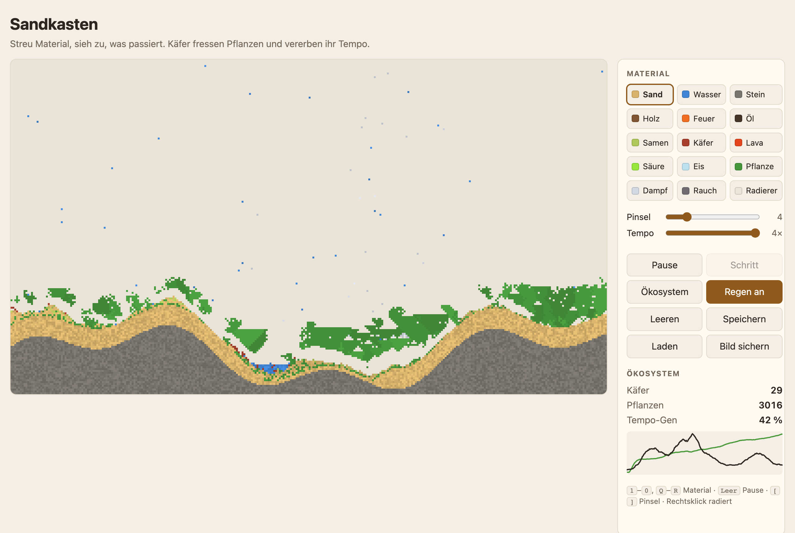

# Sandkasten

[Deutsche Fassung](README.de.md)

**A falling-sand sandbox in the browser with a tiny ecosystem.** Plants drink water, grow to their
full height, evaporate water and scatter seeds. Beetles look for plants, eat the shoots (the roots
stay), breed and pass on their speed gene with mutation. Fast beetles see further but burn more
energy; the average gene value and a population chart are shown next to the canvas.

With the gentle rain (it starts automatically) the ecosystem usually survives for a long time.
Without rain it dries out and the beetles die. Measured over 20,000 ticks, the beetles survive in
most starting scenes and the average gene value drifts noticeably (e.g. 128 → 78 or → 171).

No build step, no dependencies.



**Live demo:** <https://dark-player-jake.github.io/sandkasten/>

> [!NOTE]
> The user interface is in German for now. Contributions for an English UI are welcome.

## Features

- 15 materials: sand, water, stone, wood, fire, oil, seed, beetle, lava, acid, ice, plant, steam,
  smoke, eraser.
- An ecosystem with heredity: beetle speed is inherited with mutation.
- An "ecosystem" button that sets up a starting scene and turns on gentle rain.
- Pause, single step, brush size, one save slot in the browser.

## Quick start

The app uses ES modules, so it has to be served over HTTP (opening `index.html` via `file://`
does not work):

```bash
git clone https://github.com/Dark-Player-jake/sandkasten.git
cd sandkasten
python3 -m http.server 8000
```

Then open <http://localhost:8000>.

## Controls

- Left mouse button or finger paints, right mouse button erases.
- `1`–`0`, `Q`–`R`, `X` pick a material, `Space` pauses, `.` advances one step, `[` `]` change the
  brush size.

## Development

```bash
node --test
```

The tests cover the physics (sand, water, oil on water, fire including a single spark, lava, gas)
and the ecosystem (eating, breeding, germination, and a long run of the starting scene with rain
over 7,000 ticks, about 5 s).

| File | Purpose |
|---|---|
| `sim.mjs` | Simulation without DOM (type, life, color and gene arrays; bottom-up update with alternating direction) |
| `main.mjs` | Rendering via `ImageData`, input, saving, statistics |

## Contributing

Issues and pull requests are welcome. Please run `node --test` before you open a pull request and
keep the project free of dependencies and external resources.

## License

[MIT](LICENSE)
